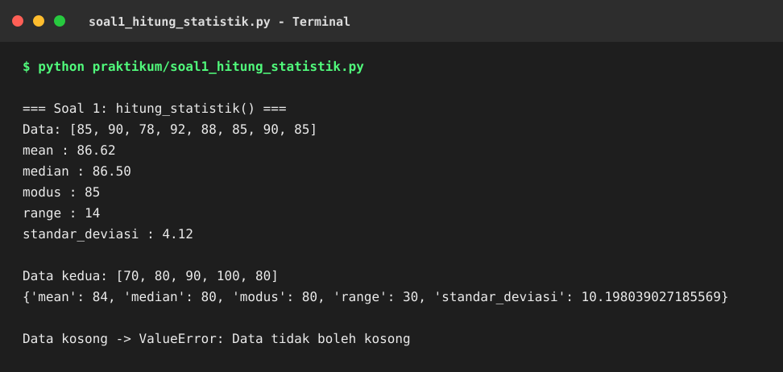
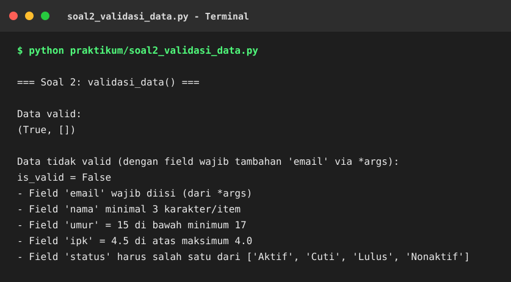
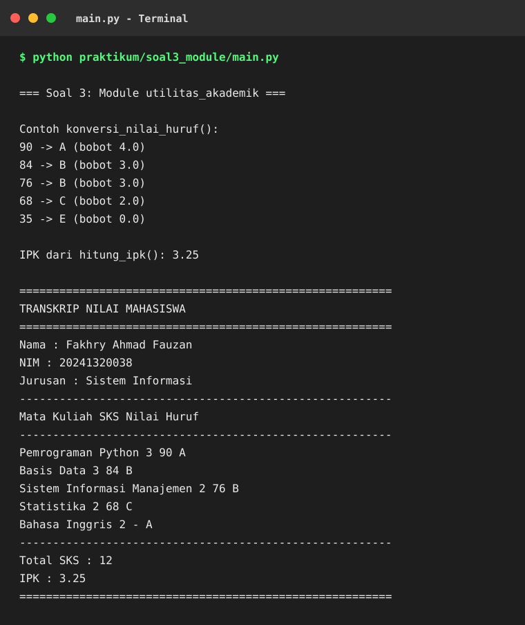
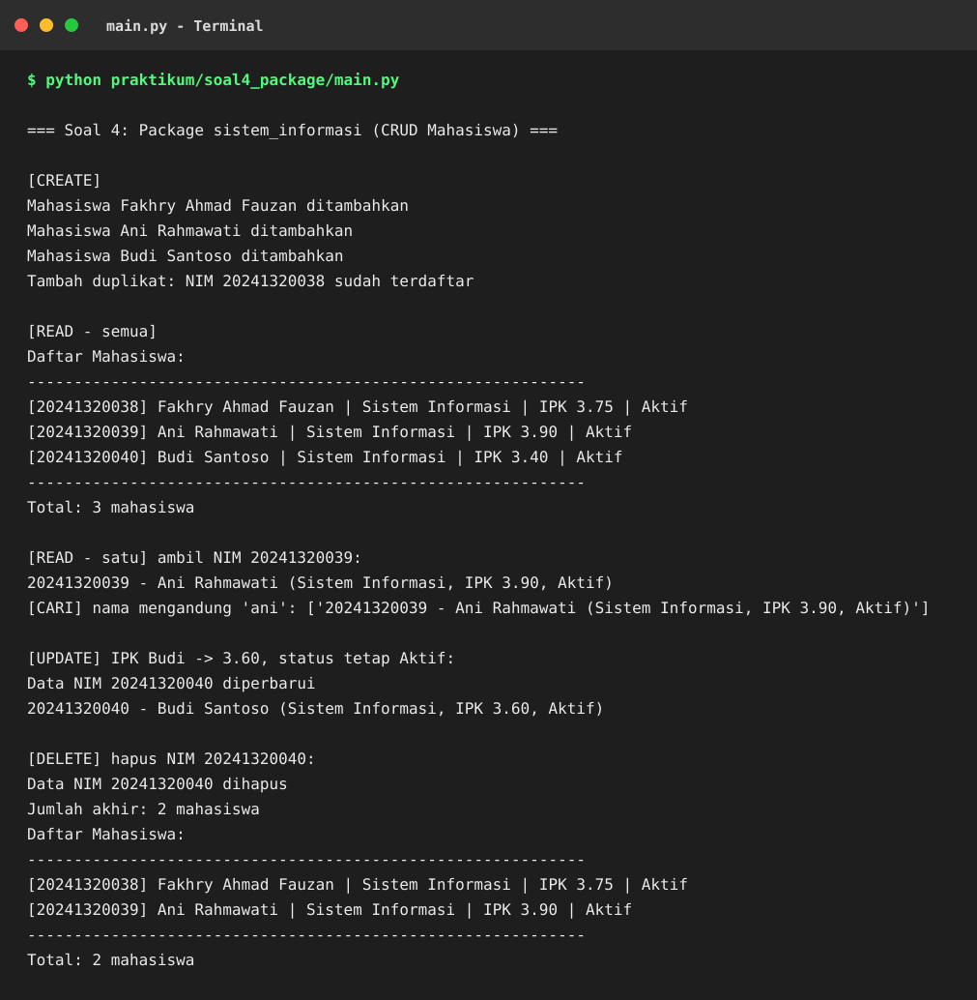
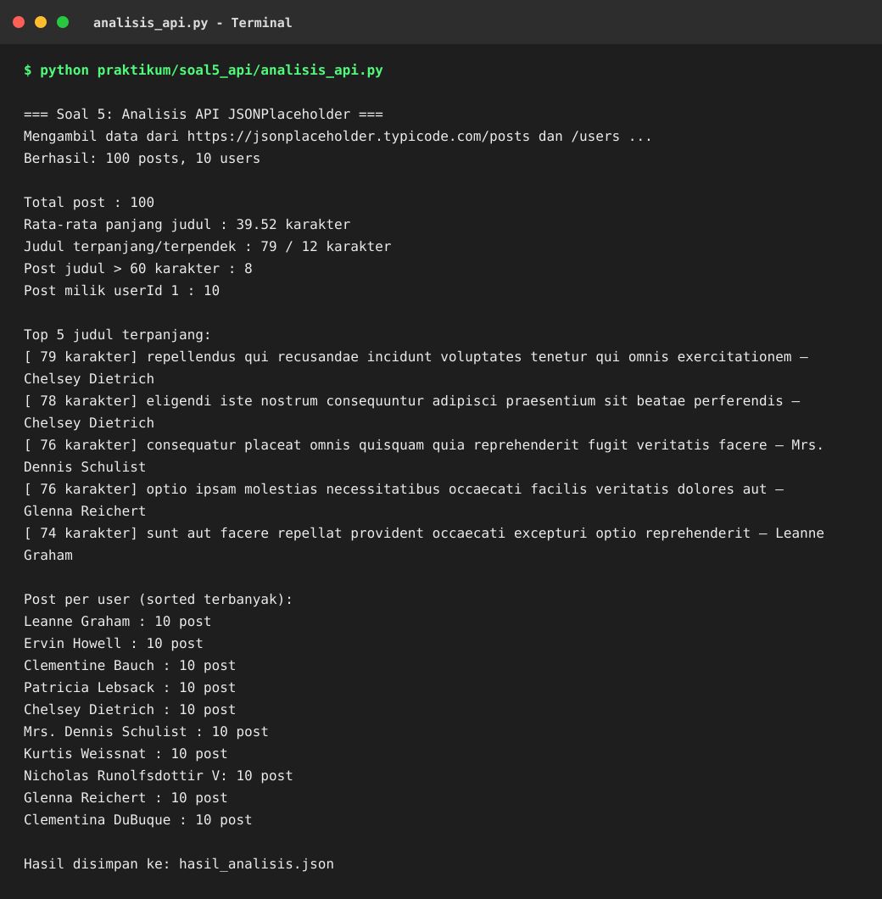

# Screenshot Hasil Praktikum

## 1. Soal 1 — hitung_statistik()

## 2. Soal 2 — validasi_data()

## 3. Soal 3 — Module utilitas_akademik

## 4. Soal 4 — Package sistem_informasi

## 5. Soal 5 — Analisis API

