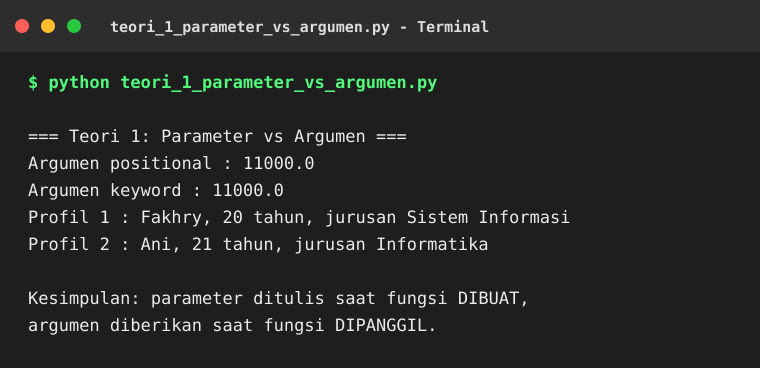
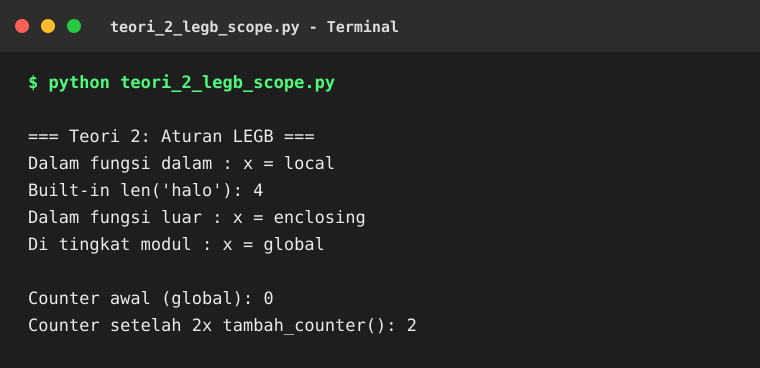
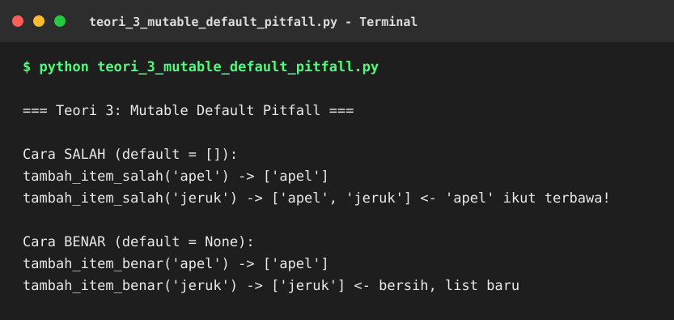
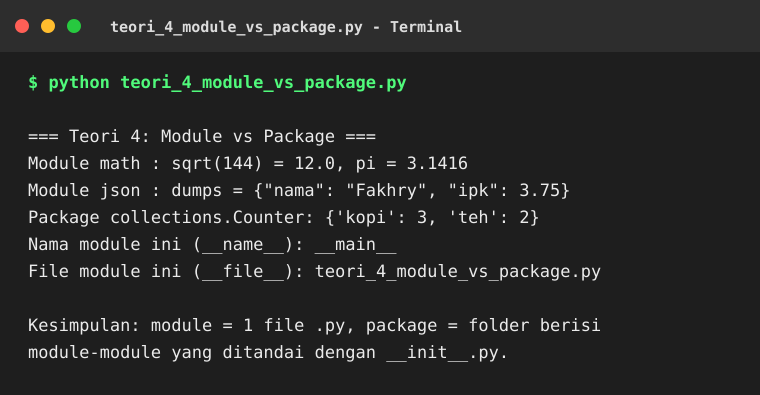
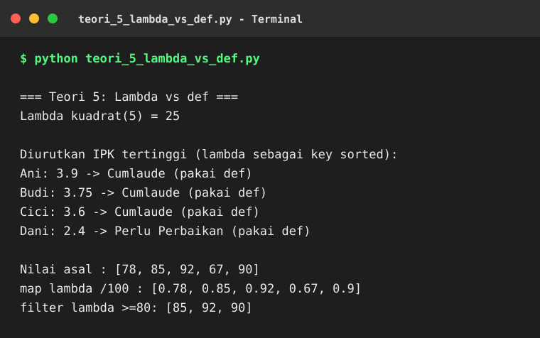

# Screenshot Hasil Teori

Folder terpisah berisi screenshot hasil pengerjaan soal teori,
satu screenshot per soal teori.
Versi `.png` dari semua screenshot ini ada di bundle ZIP yang dibagikan di chat;
di GitHub folder ini berisi versi `.svg` dengan isi yang sama persis.

## 1. Parameter vs Argumen

## 2. Aturan LEGB

## 3. Pitfall Mutable Default Parameter

## 4. Module vs Package

## 5. Lambda vs def

